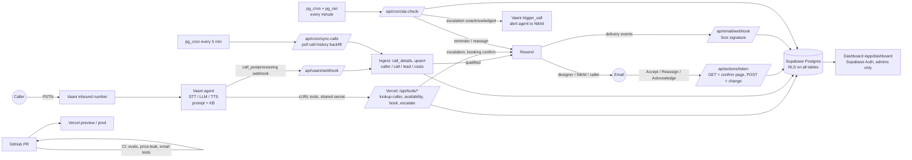

# Aangan Studio after-hours call agent: Architecture (Phase 0)

Sources read: https://docs.vaanivoice.ai (llms.txt index, 14 pages), the OpenAPI spec, and `vaani-sdk` 0.3.1 source from PyPI.
Note: `mvdocs.omind.ai` in the brief returns 404 on every path. The live docs are at `docs.vaanivoice.ai`.

## 1. What Vaani supports

| Capability | Supported? | Evidence | Notes |
|---|---|---|---|
| Inbound phone number | Yes | Telephony docs; `Deployment → Inbound` | Number provisioned in the dashboard (**paid, needs your approval**) or via BYO SIP trunk. One number routes to one agent. Set via `PATCH /api/agent/{id}/deployment`. |
| STT / TTS / LLM config | Yes | `PATCH .../persona` → `senses_capabilities` | Deepgram or AssemblyAI STT, Cartesia or ElevenLabs TTS, Gemini or GPT LLM, with fallbacks. Hindi/English auto-detect is available. **Marathi support is not documented. Needs a test.** |
| System prompt, greeting | Yes | `persona.identity` | Greeting text is configurable, so the "AI assistant, call is recorded" disclosure is encoded there. |
| Mid-call custom tools | **Yes, via cURL tools** | "Add Custom Tools via cURL" | Tools are `persona.actions.functions[]` (empty in the example, so the schema is undocumented). The docs say the endpoint must reply within 2–3 s. **I must inspect a dashboard-created tool via `GET agent` to learn the JSON shape before the push script (Phase 3).** The SDK exposes `actions` only as a raw dict. |
| Post-call event | **Yes, webhook** | Webhook Setup | `call_postprocessing` carries transcript, summary, `entities`, `dispositions`, `recording_url` and `call_duration` in **ms** (`call_ended` is in **seconds**). Registered in the dashboard (Settings → Webhooks), **not via API**. |
| Webhook signature | **Partial** | Only on the *campaign* webhooks page: `X-Vaani-Signature: sha256=…` (HMAC-SHA256, with timestamp header). | Not documented for the general webhook. Plan is to verify it if present, and also require a secret path token. **Open question for Vaani.** |
| Warm transfer | Yes | `human_transfer_*` events, `transfer_call` tool | Inbound and outbound. Used for the business-hours "transfer to studio head" option. |
| Outbound calls via API | Yes | `trigger_call(agent_id, contact_number, name, metadata, modify_agent, outbound_number)` | Used for the escalation fallback call. `modify_agent` lets us inject a per-call script, and `metadata` fills prompt variables. A separate small "alert" agent is cleaner than overriding the main one. |
| Call details | Yes | `GET /api/call_details/{id}` | Returns `transcription`, `entity`, `summary`, `call_eval_tag`, `conversation_eval`. |
| **Per-call cost** | **No** | Not in call details, call history or webhook payloads | **Gap.** Workaround: compute from `cost_rates × duration`, as the brief allows. |
| **Caller number on inbound** | **Not documented** | The `call_started` inbound payload documents `phone_number` only for outbound. | **Gap, critical for `lookup_caller`.** Candidate workarounds: (a) a prompt variable or tool-call context carrying the caller ID (needs a test call to confirm), (b) `call_history` `raw` fields, (c) the agent asks for the number. Verify in the Phase 6 test call. |
| Cross-call memory | Yes | `memories.use_previous_call_contexts`, `max_history_calls` | Native fallback for repeat callers if the caller number can't be passed to our tool. We still keep `lookup_caller` as the source of truth. |
| Knowledge base | Yes | `training.knowledge`, `use_rag`, FAQ, guardrails | Receives services.md and qualified.md **only**. Never pricing.md. |
| Post-call extraction | Yes | `analysis.extraction` | Used to produce structured lead fields, but see §3. |
| Playground | Probably via WebRTC sessions (`sessions.create`) | SDK | Used for the end-to-end test in Phase 6. |

### Gaps and workarounds
1. **No cost field.** Compute cost from `cost_rates` (rates are your input; Vaani pricing isn't in the API).
2. **Inbound caller ID not documented.** Verify by test. Fallback is native memory plus asking the caller.
3. **Webhook registration is manual** (dashboard), and signing is undocumented. Mitigations: a long random secret in the URL path, plus a **polling safety net**. `/api/cron/sync-calls` pages `GET /api/call-history` and backfills any call that has no webhook. That makes ingestion idempotent on `vaani_call_id`.
4. **Tool JSON schema undocumented.** Learn it from a dashboard-built tool first.
5. **Tool calls carry no `vaani_call_id` guarantee.** Tools must be idempotent per caller+slot. Confirm what context Vaani sends (room name?) in the test call.
6. **Marathi unverified.**
7. **Tool latency budget 2–3 s.** Routes must stay fast: no email sending inline. Use `after()` or queue the email.

## 2. Architecture

### Key design decisions
- **Webhook is the system of record trigger; polling is the net.** Both call the same `ingestCall(vaani_call_id)`, which is idempotent.
- **Qualification verdict is produced twice on purpose.** The live agent decides what to say. The post-call classifier (Gemini Flash over the transcript, run in our API, schema-validated with zod) produces the stored `rubric_verdict`, `outcome` and `decline_reason`. This is also what the eval suite tests, and it stops the agent's in-call improvisation from corrupting data.
- **Tools run with the service-role key server-side only.** The dashboard uses the user session plus RLS, with an `admins` allow-list.
- **Action tokens:** 32 random bytes, SHA-256 hash stored, 72 h expiry (escalations 2 h), single use. The GET page makes no change, and the POST consumes the token and updates only its `target_id`.
- **Emails carry a summary and a dashboard link only.** They show the last 4 digits of the phone number and no transcript.
- **SLA loop** (`pg_cron → pg_net → /api/cron/sla-check`) uses the `config` table values, and the outbound call is guarded by `fallback_call_at IS NULL` to prevent duplicates.
- **Price safety is layered.** The agent has no numbers in its context. The prompt carries the verbatim script. The CI price-leak test is the backstop.

## 3. Business-rule conflicts found in the source files (all go to the `config` table with TODO for Nikhil)
- Minimum timeline: qualified.md says 8–10 weeks from the consultation, services.md says 6 weeks from today, and T07 treats "3 weeks" as a fail. `min_completion_weeks = 8` as you specified.
- `commercial_min_sqft` (500) is not in services.md (T18).
- T05 is a 4BHK, 2,400 sq ft, referred by "a close friend of Nikhil's". It is flagged as a **priority** lead through the referral rule, not the 3,000 sq ft rule.
- T03's decline reason and T10's budget decline sit on different criteria, so `decline_reason` needs an enum: `area | advice_only | timeline | budget | too_small | out_of_scope | other`.

## 4. Blockers before I can continue (see my message)
1. `/context` does not exist on this machine. I found services.md, qualified.md, pricing.md and the enquiries PDF in `~/Downloads`, but **no `ui/ForceFieldBackground.tsx`/`.md`** (needed in Phase 5).
2. Repo location: this session runs in a temporary scratch folder.
3. Paid resources: Vaani number, Resend domain, Supabase project, Vercel plan.
